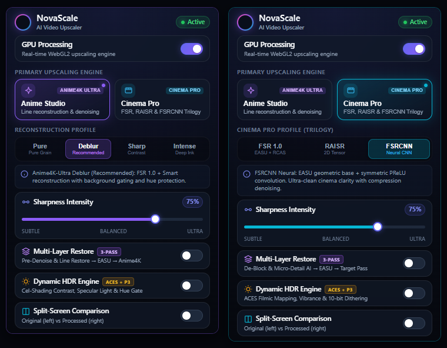
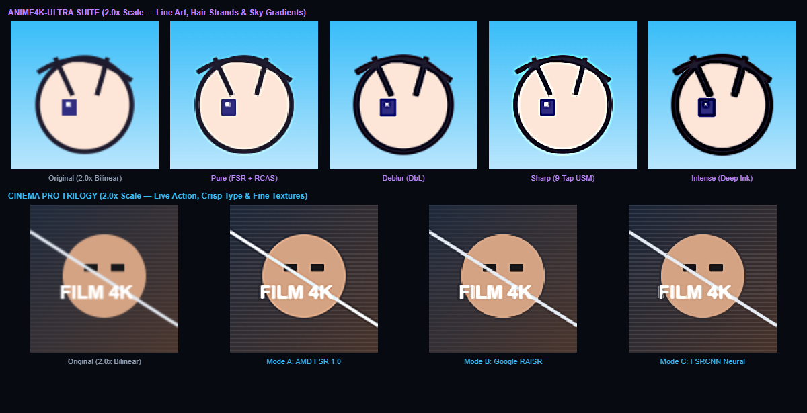

# NovaScale — Real-Time WebGL2 & WebGPU AI Video Upscaler

[](https://github.com/ShionBanned/NovaScale/releases/tag/v3.8.0)
[](manifest.json)
[](#architecture--pipeline)
[](#3-next-gen-webgpu-engine-corewebgpu)
[](#2-native-ai-sidecar-daemon-native-daemon)
[](LICENSE)

**[English](README.md)** · **[Español](README_ES.md)**

> **Hardware-accelerated, studio-grade real-time super-resolution running natively in your browser.**  
> Powered by **Native WebGL2 (`#version 300 es`)**, **Next-Gen WebGPU (WGSL Compute)**, an **Out-of-Process Rust AI Sidecar Daemon (DirectML / TensorRT / CUDA)**, **AMD FidelityFX FSR 1.0 (EASU + RCAS)**, **Google RAISR**, **FSRCNN Neural**, **APISR & SPAN 2x Models**, **3-Pass Multi-Layer Restore**, and **Dynamic ACES + P3 HDR** at 60–120 FPS.

<p align="center">
  
</p>

---

## Key Highlights & Innovations (v3.8.0)

- **Tri-Engine Synergy:** Seamlessly switch between zero-latency in-browser **WebGL2**, next-gen **WebGPU**, and deep out-of-process **Native AI Super-Resolution (Rust + ONNX Runtime)**.
- **Deep Neural 2x Models:** Native integration with **APISR** (Anime Production Inspired Real-World Anime Super-Resolution) and **SPAN** (Swift Parameter-free Attention Network) supporting dynamic NCHW float32 input resolutions.
- **Main World Early CORS Injector (`scripts/injector.js`):** Runs at `document_start` in the `MAIN` execution world. Intercepts `<video>` creation, pierces both open and closed `ShadowRoot` hierarchies, enforces `crossOrigin = "anonymous"`, and protects MediaSource/MSE blobs (YouTube, Twitch, Netflix) from CORS invalidation.
- **Sub-Bit Visibility & MPO Hardware Overlay Bypass:** Utilizes sub-pixel opacity (`opacity: 0.0001`) under the WebGL/WebGPU surface. Prevents Blink from suspending `requestVideoFrameCallback` (rVFC) and disables Windows 11 Multi-Plane Overlay (MPO) micro-stutters.
- **4K High-Throughput WebSocket Framing:** Dedicated native binary bridge (`core/native-bridge/native-client.js`) handling up to 128 MB frame buffers for uncompressed, loss-free 4K video scaling.
- **Interactive Mouse Laser Split-Screen:** Real-time dual-viewport curtain driven by mouse coordinates for instant, pixel-perfect comparison between raw source and enhanced video.

---

## Core Engines & Upscaling Profiles

NovaScale isolates shader and tensor mathematical pipelines according to source media domains: anime filters never over-smooth human skin, while cinematic neural filters protect natural organic film grain.

### 1. Anime Studio — *Anime4K-Ultra Suite (FSR 1.0 Base)*
Every Anime Studio profile starts with an **AMD FSR 1.0 (12-Tap EASU)** directional contour base, followed by domain-specific line thinning, bilateral denoising, and chromatic aberration compensation:

| Profile | Shader Pipeline | Best Use Case | Background & Flat Preservation |
| :--- | :--- | :--- | :---: |
| **Pure** (`anime-pure`) | FSR 1.0 EASU + Official AMD RCAS + Soft Thin AA | Classic cell animation (Studio Ghibli, 90s OVA), watercolor backgrounds, heavy film grain | Maximum (`~100%` intact) |
| **Deblur** (`anime-dbl`) *(Default)* | FSR 1.0 EASU + Sobel Line Thinning + Gated DoG + Hue Gate | Modern 1080p/720p anime streaming on YouTube, Crunchyroll, and web players | High (hue & background protected) |
| **Sharp** (`anime-sharp`) | FSR 1.0 EASU + High-Frequency 9-Tap Unsharp Masking (USM) | Crisp eye highlights, fine hair strands, mechanical drawings | Moderate-High |
| **Intense** (`anime-dbh`) | FSR 1.0 EASU + Aggressive Forward Warp + Deep Ink Punch | Rescuing soft or heavily compressed 480p / 360p legacy streams | Targeted contour punch |

### 2. Cinema Pro — *Live-Action Trilogy*
| Mode | Pipeline & Mathematics | Technical Architecture | Key Strength |
| :--- | :--- | :--- | :--- |
| **Mode A: AMD FSR 1.0** (`cinema-fsr`) | GPUOpen `EASU` 12-Tap + `RCAS` | Elliptical directional Lanczos-like filtering + Contrast-Adaptive Sharpening | Maximum spatial punch, edge clarity, zero latency |
| **Mode B: Google RAISR** (`cinema-raisr`) | Continuous $C^1$ 2D Structure Tensor + Anisotropic Filter | Computes orientation $\theta$, eigenvalues $\lambda_1, \lambda_2$, and coherence $\mu$ across pixel quads | Halo-free natural faces, preserves organic film grain |
| **Mode C: FSRCNN Neural** (`cinema-fsrcnn`) | EASU Geometric Base + Symmetric Zero-Mean Convolution + PReLU | Orthogonal normal/tangent feature extraction with noise coring gates | Anti-aliased diagonals, clean subtitles, zero ringing |

<p align="center">
  
</p>

---

## Architecture & Deep Tech Stack

### 1. In-Browser WebGL2 Engine (`scripts/webgl-engine.js`, `scripts/shaders.js`)
- **Native WebGL2 (`#version 300 es`) FBO Pipeline:** Employs exact integer `texelFetch` + `textureSize` in Pass-1 spatial bases, structural confidence packing in Alpha (`.a`), native `tanh()` in FSRCNN, and hardware `fwidth()` screen derivatives.
- **3-Pass Multi-Layer Restore:** Optional Layer-0 native-grid pre-restoration (`pass0_Restore_Anime` bilateral denoiser & stroke pre-thinning; `pass0_Restore_Cinema` macroblock de-blocking & micro-texture recovery) paired with `mlBoost` Pass-2 amplification.
- **Dynamic HDR Engine (`ACES + P3`):** Domain-aware tone curves (Cel S-Curve + Hue Gate for Anime; ACES Filmic Contrast + Shadow Toe for Cinema), skin-protected Local Tone Mapping, muted chroma vibrance, and 10-bit Interleaved Gradient Noise dithering (`gl_FragCoord.xy`).
- **Hybrid DRM-Safe Fallback (`Engine B`):** Automatic zero-read fallback using GPU-accelerated SVG `<feConvolveMatrix>` & `<feComponentTransfer>` filters on EME/Widevine protected players (Netflix, Disney+, Max, Prime Video, Apple TV+) while maintaining zero-copy WebGL2 on open MSE/HTTP streams.

### 2. Native AI Sidecar Daemon (`native-daemon/`)
For users with dedicated modern GPUs seeking true deep learning super-resolution beyond shader approximation:
- **High-Performance Rust Backend:** Built with `tokio`, `tokio-tungstenite`, and `ort` (ONNX Runtime 1.18).
- **Execution Providers:**
  - **DirectML (`ort/directml`):** Zero-configuration hardware acceleration across all modern DirectX 12 GPUs (NVIDIA, AMD Radeon, Intel Arc).
  - **TensorRT & CUDA (`ort/tensorrt`, `ort/cuda`):** Maximum throughput FP16 execution on NVIDIA RTX hardware.
- **Shipped Checkpoints:**
  - `apisr_anime_x2_fp16.onnx`: APISR 2x super-resolution tuned for animation and cel-shaded visuals.
  - `span_cinema_x2_fp16.onnx`: SPAN 2x swift parameter-free attention model for photorealistic live action.
- **128 MB Frame Streaming:** Native binary packets `[u32 width][u32 height][RGBA8 payload]` over `ws://127.0.0.1:19480/novascale-stream`.

### 3. Next-Gen WebGPU Engine (`core/webgpu/`)
- Pure **WGSL** compute and fragment shaders delivering hardware-bound compute rasterization without GLSL translation overhead.

---

## Installation & Setup

### Browser Extension Setup (Chrome / Edge / Brave / Opera / Vivaldi)
1. Clone or download this repository:
   ```bash
   git clone https://github.com/ShionBanned/NovaScale.git
   ```
2. Open your browser's extension management page (`chrome://extensions/` or `edge://extensions/`).
3. Enable **Developer mode** in the top-right switch.
4. Click **Load unpacked** and select the `NovaScale` folder containing `manifest.json`.
5. Pin **NovaScale** to your browser toolbar.

### (Optional) Running the Native AI Sidecar Daemon
To unlock deep learning APISR / SPAN super-resolution:
1. Ensure [Rust](https://rustup.rs/) is installed.
2. Open a terminal in `native-daemon/`:
   ```powershell
   cd native-daemon
   cargo run --release --features directml
   ```
3. The daemon will start listening on `ws://127.0.0.1:19480/novascale-stream`. The extension will automatically connect and route frames when Deep Mode is enabled.

---

## Diagnostics & Verification

NovaScale includes a built-in diagnostic test suite. Open [diag.html](diag.html) directly in your browser to verify:
- WebGL2 and WebGPU hardware capability and extension support.
- Native WebSocket Sidecar Daemon connectivity and round-trip latency.
- Dynamic HDR ACES/P3 color profile compatibility.

---

## Localization (`en` / `es`)

NovaScale features native Chromium internationalization (`chrome.i18n`) via:
- [`_locales/en/messages.json`](_locales/en/messages.json) (English — Default)
- [`_locales/es/messages.json`](_locales/es/messages.json) (Español)

---

## License & Attributions

NovaScale is open-source software licensed under the [**MIT License**](LICENSE).

Academic research citations and upstream licenses:
- **AMD FidelityFX FSR 1.0 (EASU + RCAS):** GPUOpen (MIT License)
- **Anime4K & Anime4K-Ultra Suite:** bloc97 (MIT License)
- **Google Research RAISR:** Romano, Isidoro, & Milanfar (`arXiv:1606.01299`)
- **FSRCNN:** Dong, Loy, & Tang (`arXiv:1608.00367`)
- **APISR:** Kiteretsu77 (`arXiv:2403.01598`)
- **SPAN:** Yuan, et al. (`arXiv:2404.14869`)

For complete license notices, see [**THIRD_PARTY_LICENSES.md**](THIRD_PARTY_LICENSES.md) and [**NOTICE**](NOTICE).