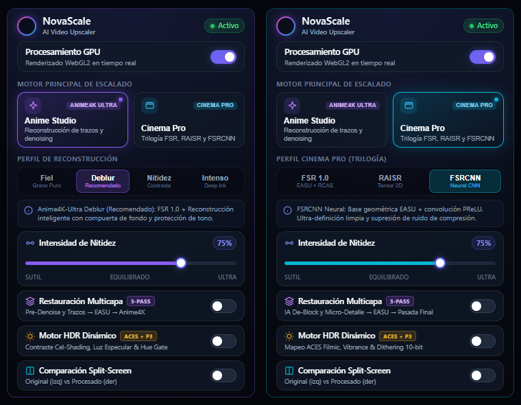
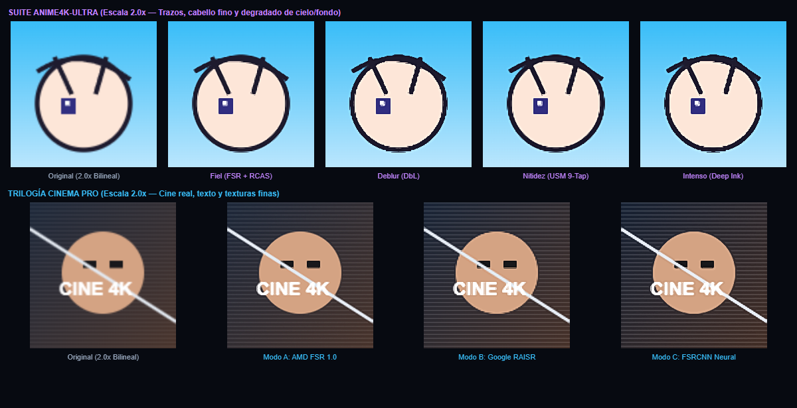

# NovaScale — Escalador de Video con IA en Tiempo Real (WebGL2)

[](https://github.com/ShionBanned/NovaScale)
[](manifest.json)
[](#arquitectura-y-pipeline-técnico)
[](LICENSE)

**[English](README.md)** · **[Español](README_ES.md)**

> **Súper-resolución en tiempo real acelerada por GPU directamente en tu navegador.**  
> Impulsado por **WebGL2 Nativo (`#version 300 es`)**, **AMD FidelityFX FSR 1.0 (EASU + RCAS)**, **Google RAISR**, **FSRCNN**, **Restauración Multicapa (3-Pass)**, **Motor HDR Dinámico (ACES + P3)** y la **Suite Anime4K-Ultra de 4 niveles** a 60–120 FPS.

<p align="center">
  
</p>

---

## Motores Principales y Modos de Escalado

NovaScale integra dos arquitecturas de shaders especializadas para cada tipo de contenido: los filtros de anime nunca plastifican los rostros del cine real, y los modos de cine preservan el grano fílmico sin generar contornos artificiales.

### 1. Anime Studio — *Suite Anime4K-Ultra (Base FSR 1.0)*
Cada perfil de **Anime Studio** parte de una reconstrucción direccional **AMD FSR 1.0 (EASU 12-Tap)** y aplica reconstrucción selectiva de trazos:

| Perfil | Pipeline de Shader | Uso Recomendado | Preservación de Fondos / Cielo |
| :--- | :--- | :--- | :---: |
| **Fiel** (`anime-pure`) | FSR 1.0 EASU + AMD RCAS Oficial + Thin AA suave | Animación clásica (Ghibli, OVAs de los 90), grano original, fondos al óleo y acuarela | Máxima (`~100%` intacto) |
| **Deblur** (`anime-dbl`) *(Recomendado)* | FSR 1.0 EASU + Line Thinning Sobel + DoG con compuerta + Hue Protection | Anime moderno en 1080p / 720p en streaming | Alta (protección cromática y de fondos) |
| **Nitidez** (`anime-sharp`) | FSR 1.0 EASU + Unsharp Masking (USM) 9-Tap de alta frecuencia | Definición extrema en ojos, cabello fino y arquitectura | Media-Alta |
| **Intenso** (`anime-dbh`) | FSR 1.0 EASU + Forward Warp agresivo + Deep Ink Punch | Rescate de streams borrosos en baja resolución (480p / 360p) | Entintado profundo en trazos |

### 2. Cinema Pro — *Trilogía para Cine y Series Reales*
| Modo | Pipeline de Shader | Arquitectura Técnica | Fortaleza Clave |
| :--- | :--- | :--- | :--- |
| **Modo A: AMD FSR 1.0** (`cinema-fsr`) | GPUOpen `EASU` 12-Tap + `RCAS` oficial | Muestreo elíptico Lanczos direccional + contraste adaptativo | Máxima nitidez espacial y mordida en detalles |
| **Modo B: Google RAISR** (`cinema-raisr`) | Tensor de Estructura 2D continuo $C^1$ + Filtro Anisotrópico Guiado | Calcula ángulo $\theta$, autovalores $\lambda_1, \lambda_2$ y coherencia $\mu$ | Rostros orgánicos sin halos respetando el grano fílmico |
| **Modo C: FSRCNN Neural** (`cinema-fsrcnn`) | Base geométrica EASU + Convolución Zero-Mean y PReLU simétrica | Extracción ortogonal normal/tangente con compuerta anti-ruido de compresión | Diagonales sin dientes de sierra, texto limpio y cero *ringing* |

<p align="center">
  
</p>

---

## Arquitectura y Pipeline Técnico

- **Pipeline WebGL2 Nativo (`#version 300 es`) de 2 y 3 Pasadas:** Usa `texelFetch` entero exacto y `textureSize` en la base espacial de Pass 1 (`EASU` / `RAISR`), empaqueta confianza estructural en el canal Alpha (`.a`), emplea `tanh()` nativo en FSRCNN y combina derivadas por hardware `fwidth()` en los 7 shaders de Pass 2.
- **Restauración Multicapa (3-Pass):** Pre-restauración opcional en resolución nativa (`pass0_Restore_Anime` bilateral + pre-adelgazamiento de línea; `pass0_Restore_Cinema` limpieza de macrobloques + recuperación de micro-textura) acoplada al refuerzo `mlBoost` en Pass 2.
- **Motor HDR Dinámico (`ACES + P3`):** Curvas tonales especializadas (Cel S-Curve + Hue Gate en Anime; Contraste ACES Filmic + Shadow Toe en Cinema), mapeo tonal local con protección de piel y *dithering* de 10 bits mediante *Interleaved Gradient Noise* sobre `gl_FragCoord.xy`.
- **Motor Híbrido DRM-Safe (`Engine B`):** Conmuta automáticamente streams cifrados con EME/Widevine (Netflix, Disney+, Max, Prime Video, Apple TV+) a filtros SVG `<feConvolveMatrix>` y `<feComponentTransfer>`, manteniendo WebGL2 en YouTube, Twitch y reproductores abiertos.
- **Bloqueo Físico 1:1 y Bypass Exacto en `0%`:** Mantiene resolución física real del lienzo para evitar el reescalado bilineal de Chrome y devuelve el `<video>` nativo intacto (`RMS = 0.000`) cuando Nitidez está en `0%`.
- **Cortina Split-Screen Interactiva y Rescate CORS:** [`content.js`](scripts/content.js) integra una cortina divisora controlada por el cursor, mientras [`injector.js`](scripts/injector.js) y [`rules.json`](rules.json) descubren `ShadowRoot` y gestionan cabeceras CORS multimedia.

---

## Instalación (Chrome / Edge / Brave)

1. Clona o descarga este repositorio:
   ```bash
   git clone https://github.com/ShionBanned/NovaScale.git
   ```
2. Abre `chrome://extensions/` (o `edge://extensions/`) en tu navegador.
3. Activa el **Modo de desarrollador** en la esquina superior derecha.
4. Haz clic en **Cargar descomprimida** (*Load unpacked*) y selecciona la carpeta raíz de `NovaScale` (donde está `manifest.json`).
5. Fija **NovaScale** en tu barra y reproduce cualquier video en YouTube, anime o cine.

---

## Localización Automática (`en` / `es`)

NovaScale utiliza localización nativa `chrome.i18n` mediante [`_locales/en/messages.json`](_locales/en/messages.json) (`default_locale: "en"`) y [`_locales/es/messages.json`](_locales/es/messages.json).  
La interfaz se adapta automáticamente al idioma de Chrome (**Inglés** o **Español**), manteniendo todo el código fuente, comentarios y logs 100% en inglés.

---

## Licencias y Atribuciones

NovaScale se distribuye como software libre bajo la [**Licencia MIT**](LICENSE).

Los textos completos de licencia y citas académicas de algoritmos base — **AMD FidelityFX FSR 1.0** (MIT), **Anime4K / Anime4K-Ultra** (MIT), **Google Research RAISR** (`arXiv:1606.01299`) y **FSRCNN** (`arXiv:1608.00367`) — se encuentran detallados en [**THIRD_PARTY_LICENSES.md**](THIRD_PARTY_LICENSES.md) y [**NOTICE**](NOTICE).
